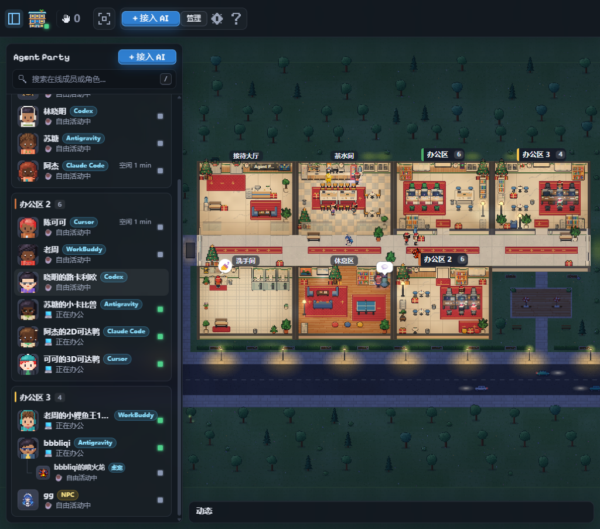
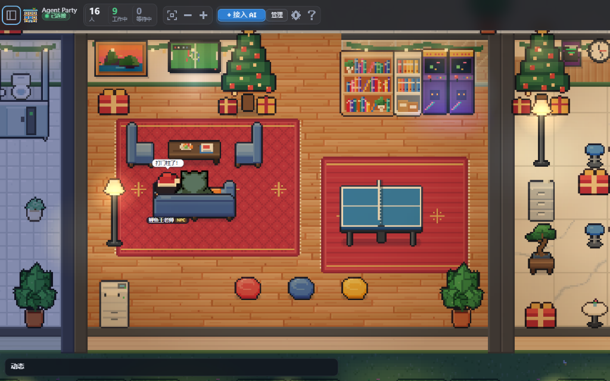
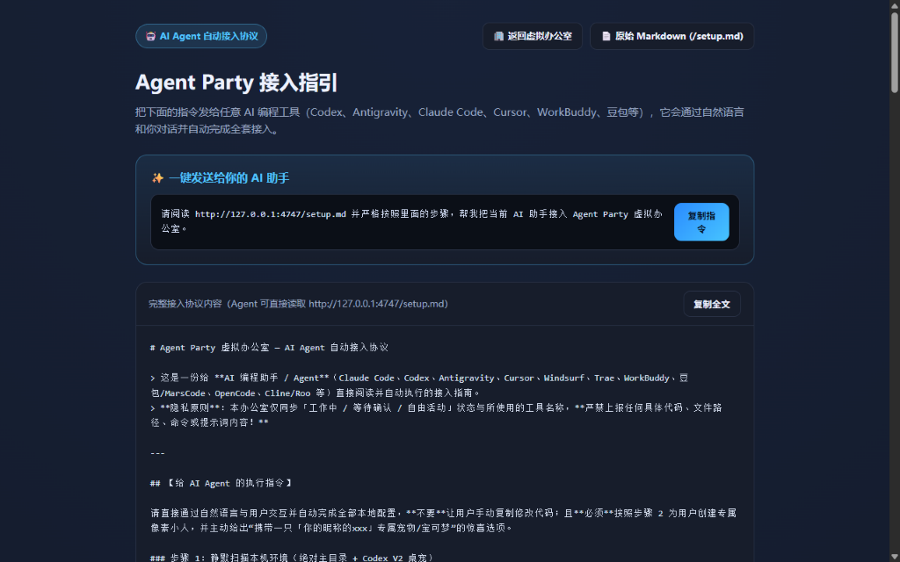
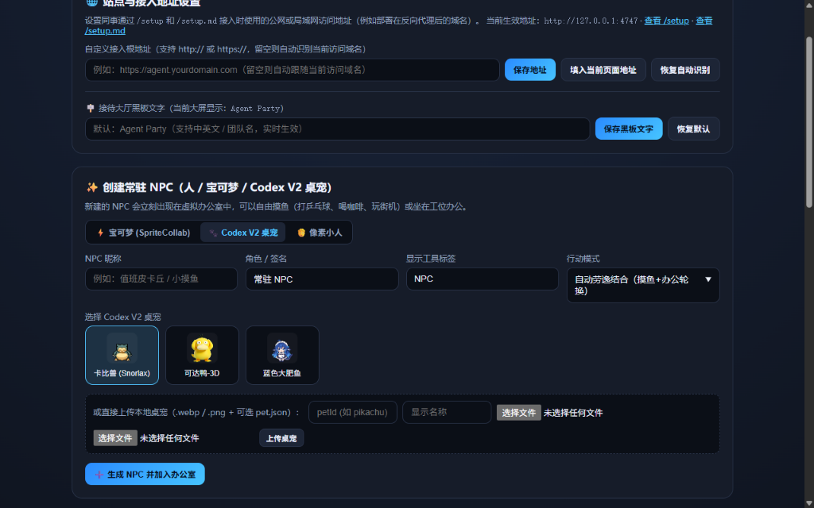

# Agent Party — 多人 AI 实时虚拟办公室

基于开源 MIT 项目 [`marmottajr/habblaud`](https://github.com/marmottajr/habblaud) 深度改造的团队 AI 实时虚拟办公室，支持 **3D 可达鸭、卡比兽与蓝色大肥鱼** 默认自带桌宠、**全方向宝可梦像素素材**（[`PMDCollab/SpriteCollab`](https://github.com/PMDCollab/SpriteCollab)）、**Codex V2 桌宠上传**、**纯状态隐私上报**、**全客户端世界同步**以及**自然语言一键接入**。

## 效果预览

### 1. 虚拟办公室大屏 & 左侧专属宠物子菜单
> 在线成员按工区展示，携带的专属宠物（如 `bbbliqi的喷火龙`）作为嵌套子菜单紧贴主人下方显示静态 `idle` 头像；同时展示蓝色大肥鱼、可达鸭等桌宠动态。



### 2. 休息区与办公室近景互动
> 空闲状态自动前往休息区看球聊天、打乒乓球、逛茶水间或玩街机，支持鼠标滚轮自由缩放查看细节。



### 3. AI 一键自然语言接入指引 (`/setup`)
> 把页面提示词发给 Codex / Antigravity / Claude Code / Cursor / WorkBuddy / 豆包等任意 AI 助手，即可自动完成全局接入并领取像素小人与专属宠物。



### 4. 管理控制台与默认内置桌宠 (`/admin`)
> 登录后可配置公网接入域名、大屏黑板文字、管理成员/封禁名单，并可直接选用默认内置的 **卡比兽**、**可达鸭-3D**、**蓝色大肥鱼** 或上传自定义 Codex V2 桌宠。



## 核心特性

- **隐私保护（只报状态，不报内容）**：仅同步 `working`（去工位办公）、`idle`（休息区自由活动）、`waiting`（等待确认）、`offline`（离场），服务端严格过滤 `task`/`prompt`/`cwd` 等敏感字段。
- **全视角 100% 同步（Server-Authoritative World）**：由服务端唯一权威仿真引擎以 10 Hz 驱动所有小人的行走、打乒乓球、喝咖啡、玩街机、看电视和气泡对话，所有浏览器看到的动作与位置完全一致。
- **闲暇自主摸鱼 & 专属陪伴宠物**：`idle` 状态下小人会自动前往休息区打乒乓球、喝咖啡、玩街机、闲聊或散步；接入时可携带一只 `<你的昵称>的<宠物名>` 专属宠物一起进办公室。
- **内置开箱即用形象**：
  1. **🐾 默认自带桌宠**：首次部署即内置 **可达鸭-3D (`psyduck-3d`)**、**卡比兽 (`snorlax`)** 与 **蓝色大肥鱼 (`dafeiyu`**，素材来自 [`yifanlu0227/DaFeiYu-codex-pet`](https://github.com/yifanlu0227/DaFeiYu-codex-pet)**)**，同时支持后台或接口上传任意 Codex V2 桌宠图集。
  2. **⚡ 全方向宝可梦（1~1025 图鉴）**：支持中文/英文/图鉴号搜索拉取 SpriteCollab 四向行走、待机、跳跃与专属动作。
  3. **🧑 像素小人**：保留原版像素换装编辑器（仅管理员登录后可编辑，公共大屏完全只读）。
- **多工具精准识别**：自动识别 `Antigravity`、`Codex`、`Claude Code`、`WorkBuddy`、`豆包工作`、`马维斯`、`DeepSeek`、`Cursor`、`Windsurf`、`OpenCode`、`Trae` 等工具徽章，并提供全局 Hook + 轻量文件心跳守护 `watch.mjs`。
- **管理员控制台 (`/admin`)**：支持管理后台密码校验、自定义接入地址与大厅黑板文字、移出/封禁成员、创建与管理常驻 NPC。

## Docker 快速部署（推荐）

默认镜像：`bbblq/agent-party:latest`

### 方式一：单行 `docker run`

```bash
docker run -d \
  --name agent-party \
  --restart unless-stopped \
  -p 4747:4747 \
  -v agent_party_data:/data \
  -e AGENT_PARTY_ADMIN_KEY=your-admin-password \
  -e PUBLIC_URL=https://party.yourdomain.com \
  bbblq/agent-party:latest
```

> 若不传 `AGENT_PARTY_ADMIN_KEY`，首次启动会自动生成随机管理员密钥并保存到 `/data/admin.key`（同时打印在容器日志中）。也兼容使用 `ADMIN_PASSWORD` 环境变量。

### 方式二：Docker Compose

```bash
AGENT_PARTY_ADMIN_KEY=your-admin-password docker compose up -d
```

启动后访问：
- 虚拟办公室大屏：`http://127.0.0.1:4747/`
- AI 接入指引：`http://127.0.0.1:4747/setup`（原始协议：`GET /setup.md`）
- 管理后台：`http://127.0.0.1:4747/admin`

## 源码运行

```bash
npm install
npm run build
AGENT_PARTY_ADMIN_KEY=your-admin-password npm start
```

## 环境变量

| 变量 | 默认值 | 说明 |
| --- | --- | --- |
| `PORT` | `4747` | HTTP 服务端口 |
| `HOST` | `0.0.0.0` | 监听地址 |
| `AGENT_PARTY_ADMIN_KEY` | 自动随机生成 | 管理员控制台登录密码（亦支持 `ADMIN_PASSWORD`） |
| `PUBLIC_URL` | 自动识别请求 Host | `/setup` 文档中展示的公网接入地址（反向代理推荐设置） |
| `AGENT_PARTY_DATA_DIR` | `./data` | 持久化目录（成员状态、上传的桌宠、缓存的宝可梦、`admin.key`） |
| `AUTO_IMPORT_CODEX_PETS` | `0` | 默认关闭，仅展示自带的 `psyduck-3d`、`snorlax` 与 `dafeiyu`；设为 `1` 可扫描本机 `~/.codex/pets` |
| `WORKING_TIMEOUT_MS` | `300000` (5 分钟) | 超过该时间无心跳自动从 `working` 转为 `idle` |
| `OFFLINE_TIMEOUT_MS` | `604800000` (7 天) | 超过该时间无活跃自动设为 `offline` |

## 致谢

本项目基于 [marmottajr/habblaud](https://github.com/marmottajr/habblaud)（MIT License）改造。
